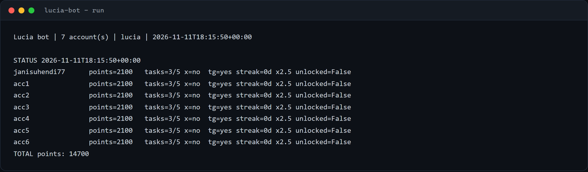

# Lucia Protocol Quest Bot

**Versi:** 1.0.0 · **Harga:** Rp 65.000 (~$4) · **Kontak pembelian:** [@rmndkyl](https://t.me/rmndkyl)

Automates the Lucia Protocol airdrop campaign at `airdrop.luciaprotocol.com` plus the Telegram entry bot `@LuciaProtocolPreTGECEXAirdropBot`. No deposit is required anywhere — the campaign only asks for an EVM address.

## Kebutuhan

| Item | Detail |
|---|---|
| Runtime | Node.js 18+ |
| Wallet | EVM / sesuai chain proyek (kamu sendiri) |
| Proxy | tidak perlu |
| Captcha | opsional (butuh key sendiri) |
| Akses | akun proyek yang kamu kelola sendiri |

## Pembayaran

E-Wallet: DANA / GoPay / ShopeePay · Bank: BCA / Seabank · Crypto: contact for wallet address.
Pembeli menghubungi [@rmndkyl](https://t.me/rmndkyl), kirim bukti transfer, lalu terima license key.

---

Automates the Lucia Protocol airdrop campaign at `airdrop.luciaprotocol.com`
plus the Telegram entry bot `@LuciaProtocolPreTGECEXAirdropBot`.
No deposit is required anywhere — the campaign only asks for an EVM address.

## What it does

| Task | Points | How the bot handles it |
|---|---|---|
| Connect wallet | 1,500 | Per-wallet SIWE signature, auto-credited on join |
| Follow Lucia on X | 300 | `--link-x` opens X OAuth once per account, then claims |
| Join Telegram group | 300 | Link code via `@Lucia_quests_agent`, auto-confirmed |
| Join announcement channel | 300 | Same Telegram identity, claimed together |
| Daily share | 50 × multiplier | `--daily` claims every day; multiplier 2.5x → 5x → 10x |

Points convert to the $LCI allocation at the end of Season 1 (campaign runs
9 Nov → 9 Dec 2026, distribution announced for 20 Jan 2027).

## Screenshot



Real output of `python main.py --status` after a live run (addresses masked; the unmasked card stays in the private repo).

## How the authentication works

1. `POST /quests/auth/nonce` returns a SIWE message for the wallet address.
2. The wallet signs it (`personal_sign`).
3. `POST /quests/auth/verify` needs **one Cloudflare Turnstile token per wallet**
   (tokens are single-use — one token cannot sign in two wallets).
4. The worker returns a Bearer token valid for **24 hours**, so a daily run needs
   one fresh Turnstile token per wallet.

The bot solves Turnstile by launching real Chrome (headed), loading the campaign
page and rendering the widget the site itself uses. Tokens arrive in ~3 s each and
the same browser session mints all of them in one go.

### Headless servers: Capsolver path

If `capsolver_key` is set in `config.json` (or `CAPSOLVER_KEY` in the env), the bot
skips the browser entirely and solves each Turnstile token with Capsolver's
`AntiTurnstileTaskProxyLess` task, one token per login (~10 s, ~$0.001 each). This
is the only path that works on a server without a desktop session; without it you
must run Chrome under `xvfb-run` and click the widget by hand.

## Requirements

| Item | Notes |
|---|---|
| Windows 10/11 | Chrome must be installed (`channel: "chrome"` is used, no browser download) |
| Python 3.11+ | deps: `telethon`, `eth-account` (installed into `.venv`) |
| Node 18+ | deps: `playwright`, `ethers` (`npm install`) |
| Telegram sessions | Telethon `.session` files, one per farming account |
| EVM wallet per account | Generated automatically with `--init-wallets` |

## Setup

```bat
:: 1. python deps (already done if .venv exists)
python -m venv .venv
.venv\Scripts\python.exe -m pip install -r requirements.txt

:: 2. node deps (skips the browser download, we use installed Chrome)
set PLAYWRIGHT_SKIP_BROWSER_DOWNLOAD=1
npm install

:: 3. config
copy config.json.example config.json
::    fill telegram.api_id / api_hash / sessions_dir, then list accounts

:: 4. wallets for every account
.venv\Scripts\python.exe main.py --init-wallets
```

`config.json` holds wallet private keys — it is gitignored. Never commit it.

## Usage

Double-click launchers (Indonesian menu) or use the CLI:

| File | Action |
|---|---|
| `JALANKAN.bat` | menu: status / login / run tasks / link X / daily / wallets |
| `CEK-POIN.bat` | points of every account |
| `SET-HARIAN.bat` | daily-share claim |
| `LINK-X.bat` | link one X account (asks for the label) |

CLI equivalents:

```bash
python main.py --status                     # points, tasks, streak per account
python main.py --login --account acc1       # refresh session (opens Chrome)
python main.py --run --account acc1         # join + wallet + telegram + claims
python main.py --run                        # all accounts
python main.py --link-x --account acc1      # X OAuth, one time per account
python main.py --daily                      # daily-share claim for all accounts
```

Runs write `data/last-run.json` and `data/last-run.txt` (machine + console log).

## One manual step: linking X

`x_follow` cannot be faked — the worker needs an X OAuth token for the account
that follows `@luciaprotocol`. Run `LINK-X.bat` once per account:

1. Chrome opens on x.com's authorize page.
2. Log in with the X account that belongs to that wallet (first time only — the
   browser profile is kept per account under `profiles/x-<label>`).
3. Press **Authorize**. The window closes by itself when the identity is attached.
4. The bot then claims `follow` and the daily streak unlocks.

Until this is done, `--daily` returns `not_unlocked` and the streak multiplier
stays at zero — the 300 follow points and every daily share depend on it.

## Points math (for planning)

- Task points: 1,500 + 300 + 300 + 300 = **2,400** per wallet.
- Daily share: 50 × 2.5 (days 1–2) → 50 × 5 (days 3–6) → 50 × 10 (day 7+).
- Sharing every day from 12 Nov to 9 Dec ≈ 12,250 from shares → **~14,650 points
  per wallet**. Seven wallets ≈ 100k points.

## Troubleshooting

| Symptom | Cause / fix |
|---|---|
| `no token returned` from Turnstile | Chrome must run on an unlocked desktop session. Headless does not produce tokens. Close other Chrome windows using the same profile dir. |
| `verify failed (403) turnstile_failed` | Token already used or older than ~5 min. Re-run `--login` (fresh tokens). |
| `session rejected (401)` | 24h session expired — run `--login` again. |
| `already_claimed` (409) | Task already banked, nothing to do. |
| `identity_not_linked` (409) | Run `--link-tg` for that account. |
| `identity_already_linked` (409) | Telegram is linked; the bot now skips straight to claiming. |
| `x_follow_check_required` (409) | Expected until `--link-x` is done for that account. |
| Telegram link expired | The `t.me/...?start=` code dies after ~10 minutes; each `--link-tg` call mints a fresh one. |
| Bot didn't return a code | Telegram session flood-wait or the code regex missed. Retry after a minute. |
| `Could not resolve host ...workers.dev` | Local DNS drops `*.workers.dev`. The bot resolves through `8.8.8.8` and falls back to Cloudflare anycast IPs; no action needed. |
| Points not credited after claim 200 | Re-run `--status`; the campaign recomputes on every profile fetch. |

## Notes and limits

- The campaign caps points at 162.5M and ends **9 Dec 2026**; Season 2 may follow.
- Telegram entry bot (`@LuciaProtocolPreTGECEXAirdropBot`) is a separate path: it
  asks for a math captcha, channel joins and an X username (honour system), then an
  EVM address — 650 LCI + a referral leaderboard. The bot here handles the site
  campaign; the Telegram bot flow is manual (about 2 minutes per account).
- Nothing in this repo deposits, swaps or approves tokens. It only signs in,
  claims campaign points and links socials.